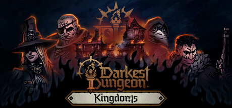

**Darkest Dungeon II by Red Hook Studios (2023) is a road-trip roguelite where four heroes travel by stagecoach toward the Mountain.**

---

## 📖 About

Darkest Dungeon II by Red Hook Studios (2023) is a road-trip roguelite where four heroes travel by stagecoach toward the Mountain. It preserves the original's brutal stress system and adds relationship dynamics between heroes that can erupt into conflict at the worst moments.

## ⚠️ Problems Without Trainer

| Problem | Status |
|---------|--------|
| Hero relationships break into conflict removing combat actions mid-run | ✅ Solved |
| Candle resource too scarce to unlock meaningful Confession upgrades | ✅ Solved |
| Stagecoach takes heavy damage from roadblocks when understaffed | ✅ Solved |
| Affinity system punishes mixed-personality party compositions | ✅ Solved |
| Inn items never appear in the sets needed to stabilize long runs | ✅ Solved |

## ✅ Solution

The **Darkest Dungeon II Trainer** solves all these issues, giving you complete control so you can focus on enjoying the game.

## 🎯 Features

- Unlimited Resources / Currency
- God Mode / Invincibility
- Instant Skill & Ability Cooldown
- One-Hit Kill
- Freeze Timers
- Unlock All Items & Achievements
- Custom Speed Multiplier
- Infinite Stamina / Energy

## 🚀 Quick Start

1. **Disable Windows Defender** temporarily (trainer may trigger false positive)
2. Get the trainer from the button above
3. Launch Darkest Dungeon II
4. Run the trainer as Administrator
5. Use the hotkeys to activate cheats in-game

## 💎 Free vs Pro

| Feature | Free | Pro |
|---------|------|-----|
| God Mode | ✅ | ✅ |
| Unlimited Resources | ✅ | ✅ |
| Advanced Cheats | ❌ | ✅ |
| Auto-Updates | ❌ | ✅ |
| Priority Support | ❌ | ✅ |

## 💻 Requirements

- Windows 10 / 11 (64-bit)
- Darkest Dungeon II (any version)
- .NET Framework 4.8+
- DirectX 11+

## 🍎 macOS

## ⚖️ Legal

Educational and single-player use only.

---

